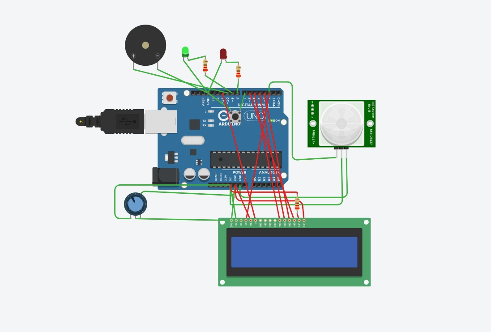
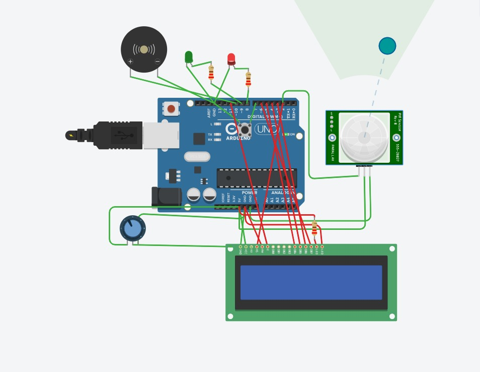

# PIR-Based Smart Room Security and Intrusion Detection System

An Arduino-based smart security system that detects movement inside a room using a PIR (Passive Infrared) sensor and provides visual and audible alerts using LEDs, a buzzer, and an LCD display. The system is designed to simulate a basic room intrusion detection and alarm system using Tinkercad Circuits.

## Project Components

The complete project consists of an Arduino Uno R3, PIR motion sensor, piezo buzzer, red and green LEDs, 220 Ω resistors, pushbutton, 16×2 LCD, and a 10 kΩ potentiometer.


## Project Demonstration

### 1. Room in Secure Condition

When no motion is detected by the PIR sensor, the system remains in its normal secure state. The green LED indicates that the room is secure, while the red LED and buzzer remain OFF. The LCD displays the current room security status.



The system operates in the following state:

```text
Green LED  → ON
Red LED    → OFF
Buzzer     → OFF

LCD:
ROOM STATUS:
SECURE
```

### 2. Motion / Intrusion Detected

When a person or object enters the detection range of the PIR sensor, the sensor sends a HIGH signal to the Arduino. The Arduino identifies this as a possible intrusion and activates the security alarm.

The red LED and buzzer are activated, while the LCD displays an intrusion warning.



The system changes to:

```text
Green LED  → OFF
Red LED    → ON
Buzzer     → ON

LCD:
!! WARNING !!
INTRUSION!
```

### 3. Alarm Reset

A pushbutton is included to reset the alarm condition. When the button is pressed, the Arduino deactivates the buzzer and red LED and returns the system to its secure state.

The green LED is turned ON and the LCD returns to the normal room-security message.

## Features

- PIR-based human motion detection
- Real-time intrusion detection
- Audible alarm using a piezo buzzer
- Red LED warning indicator
- Green LED secure-status indicator
- 16×2 LCD for displaying system status
- Pushbutton for alarm reset
- Arduino-based control system
- LCD contrast adjustment using a 10 kΩ potentiometer
- Tinkercad Circuits simulation
- Serial Monitor output for security events

## Components

- Arduino Uno R3
- PIR Sensor
- Piezo Buzzer
- Red LED
- Green LED
- 3 × 220-ohm resistors
- Pushbutton
- 16×2 LCD
- 10 kΩ Potentiometer
- Jumper wires

## Circuit Connections

| **Component** | **Arduino Connection** |
|---|---|
| PIR VCC | 5V |
| PIR OUT | D2 |
| PIR GND | GND |
| Red LED | D8 through 220 Ω resistor |
| Green LED | D9 through 220 Ω resistor |
| Buzzer positive | D10 |
| Buzzer negative | GND |
| Pushbutton | D7 |
| Pushbutton other side | GND |
| LCD RS | D12 |
| LCD E | D11 |
| LCD DB4 | D5 |
| LCD DB5 | D4 |
| LCD DB6 | D3 |
| LCD DB7 | D6 |
| LCD RW | GND |
| LCD VCC | 5V |
| LCD GND | GND |
| LCD VO | Potentiometer middle pin |
| LCD LED+ | 5V through 220 Ω resistor |
| LCD LED- | GND |

The LCD is operated in **4-bit mode**, so DB0, DB1, DB2, and DB3 are left unconnected.

Each LED is connected through a 220-ohm current-limiting resistor. The LCD backlight also uses a 220-ohm resistor to limit its current.

## How It Works

### 1. Motion Detection

The PIR sensor detects changes in infrared radiation caused by movement of a person or object within its detection range.

The sensor output is connected to Arduino digital pin D2.

When no motion is detected:

```text
PIR Output = LOW
```

When motion is detected:

```text
PIR Output = HIGH
```

The Arduino continuously reads this signal and determines the security state of the room.

### 2. Secure Room Condition

When the PIR sensor does not detect motion, the system remains in the secure state.

The system indicates:

```text
Green LED  → ON
Red LED    → OFF
Buzzer     → OFF
LCD        → ROOM STATUS: SECURE
```

### 3. Intrusion Detection

When motion is detected, the Arduino activates the alarm system.

The system changes to:

```text
Green LED  → OFF
Red LED    → ON
Buzzer     → ON
LCD        → INTRUSION WARNING
```

The LCD displays:

```text
!! WARNING !!
INTRUSION!
```

At the same time, a message is sent to the Serial Monitor:

```text
--------------------
INTRUSION DETECTED!
--------------------
```

This allows the user to monitor security events during simulation.

### 4. Alarm Reset

The pushbutton is connected to Arduino digital pin D7 and uses the Arduino's internal pull-up resistor.

When the button is pressed, the Arduino resets the alarm condition.

The system returns to:

```text
Green LED  → ON
Red LED    → OFF
Buzzer     → OFF
LCD        → ROOM STATUS: SECURE
```

This allows the alarm to be manually silenced and the system to return to normal operation.

## Security Logic

| **Room Condition** | **Green LED** | **Red LED** | **Buzzer** | **LCD Status** |
|---|---:|---:|---:|---|
| No motion detected | ON | OFF | OFF | Room Secure |
| Motion detected | OFF | ON | ON | Intrusion Detected |
| Alarm reset | ON | OFF | OFF | Room Secure |

## System Flow

```text
              START
                |
                v
        Initialize Arduino
                |
                v
       Initialize PIR Sensor
                |
                v
       Initialize LCD & LEDs
                |
                v
        Monitor PIR Sensor
                |
          +-----+-----+
          |           |
     No Motion      Motion
          |           |
          v           v
     GREEN LED     RED LED ON
        ON          BUZZER ON
          |           |
          v           v
    LCD: SECURE   LCD: INTRUSION
          |           |
          |           v
          |      Wait for reset
          |           |
          +-----<-----+
```

## Running the Project in Tinkercad

1. Open **Tinkercad Circuits**.
2. Create an Arduino Uno R3 circuit.
3. Add the required components.
4. Connect the components according to the circuit connection table.
5. Open the Arduino code editor.
6. Set the editor to **Text** mode.
7. Copy the Arduino program into the editor.
8. Start the simulation.
9. Allow the PIR sensor a few seconds to initialize.
10. Observe the LCD and green LED in the normal secure state.
11. Trigger the PIR sensor to simulate an object/person entering the room.
12. Observe the red LED, buzzer, and LCD intrusion warning.
13. Press the pushbutton to reset the alarm.

## Simulation Demonstration

### Before Object / Motion Detection

In the normal condition, the PIR sensor does not detect movement.


The system remains in the secure state:

```text
GREEN LED → ON
RED LED   → OFF
BUZZER    → OFF

LCD:
ROOM STATUS:
SECURE
```

### After Object / Motion Detection

When an object or person enters the PIR detection area, the sensor detects the movement.


The Arduino activates the alarm:

```text
GREEN LED → OFF
RED LED   → ON
BUZZER    → ON

LCD:
!! WARNING !!
INTRUSION!
```

## Applications

This project can be used as a basic model for:

- Home security systems
- Room intrusion detection
- Office security
- Laboratory security
- Classroom monitoring
- Restricted-area monitoring
- Smart home automation
- Basic anti-intrusion alarm systems

## Advantages

- Simple and low-cost security system
- Easy to implement using Arduino
- PIR sensor provides contactless motion detection
- Provides both visual and audible alerts
- LCD gives clear information to the user
- Pushbutton allows manual alarm reset
- Easy to expand with additional sensors and communication modules
- Can be simulated safely using Tinkercad before hardware implementation

## Limitations

- A PIR sensor detects motion rather than identifying a specific person.
- It cannot distinguish between an authorized and unauthorized person by itself.
- Environmental conditions can affect PIR detection.
- The system is intended as a prototype and not as a complete commercial security system.
- The Tinkercad simulation represents the behavior of the physical security system but does not provide real-world security guarantees.

## Future Improvements

The system can be further improved by adding:

- Keypad-based password authentication
- RFID-based access control
- ESP8266 or ESP32 for Wi-Fi connectivity
- Mobile notifications when an intrusion is detected
- GSM module for SMS alerts
- Camera-based verification
- Multiple PIR sensors for larger rooms
- Magnetic door/window sensors
- Cloud-based security monitoring
- Real-time event logging
- Battery backup for operation during power failures

## Technologies Used

- Arduino Uno R3
- PIR Motion Sensor
- 16×2 LCD
- Embedded C/C++
- Tinkercad Circuits
- Digital sensor interfacing
- Embedded alarm and control logic

## Project Objective

The main objective of this project is to design and simulate a simple, low-cost smart room security system capable of detecting motion and immediately notifying the user through visual, audible, and LCD-based alerts.

The project demonstrates the integration of **sensors, microcontroller programming, display interfacing, and alarm systems** to create a practical embedded security application.

## Conclusion

The **PIR-Based Smart Room Security and Intrusion Detection System** demonstrates how an Arduino Uno can be used to create a basic automated security system. The PIR sensor continuously monitors the room for movement, while the Arduino processes the sensor signal and controls the alarm indicators.

When no movement is detected, the system displays a secure status using the green LED and LCD. When motion is detected, the red LED and buzzer are activated and the LCD displays an intrusion warning. A pushbutton allows the user to reset the alarm.

The complete system was designed and tested using **Tinkercad Circuits**, providing a safe and accessible environment for developing and demonstrating the proposed security system before physical implementation.
